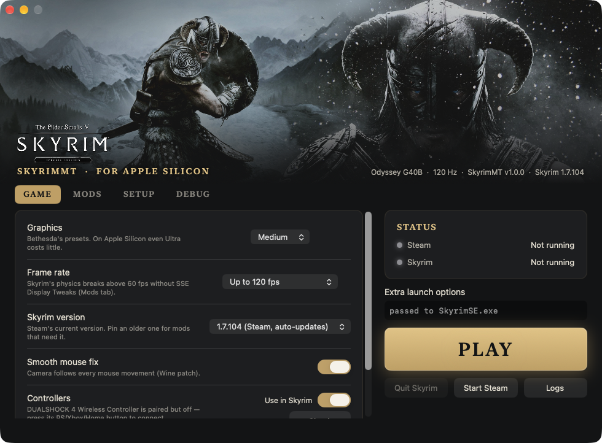
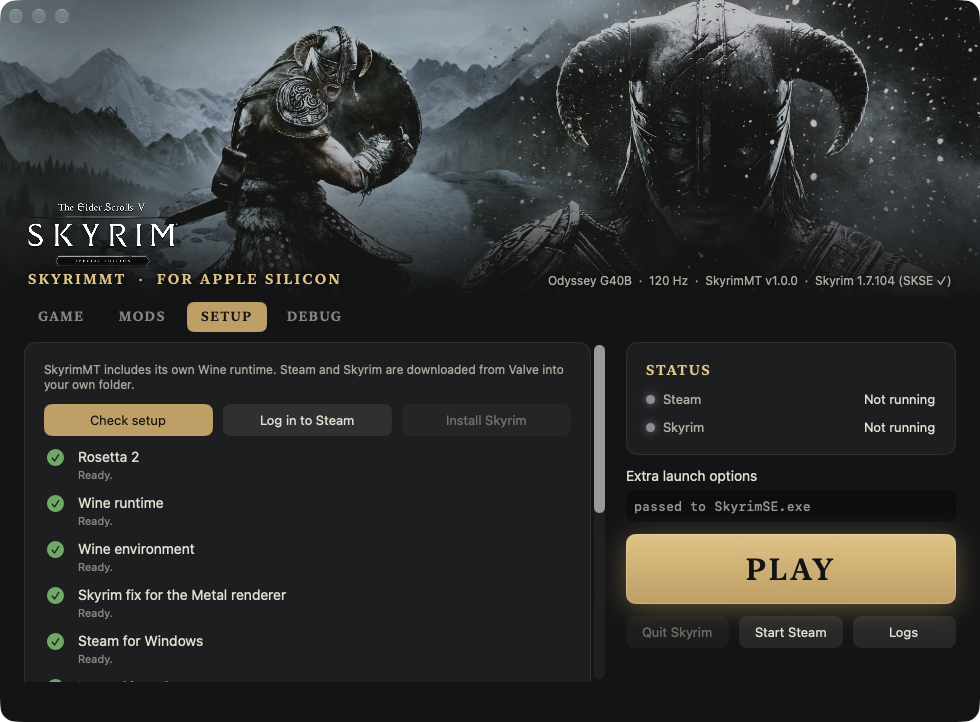
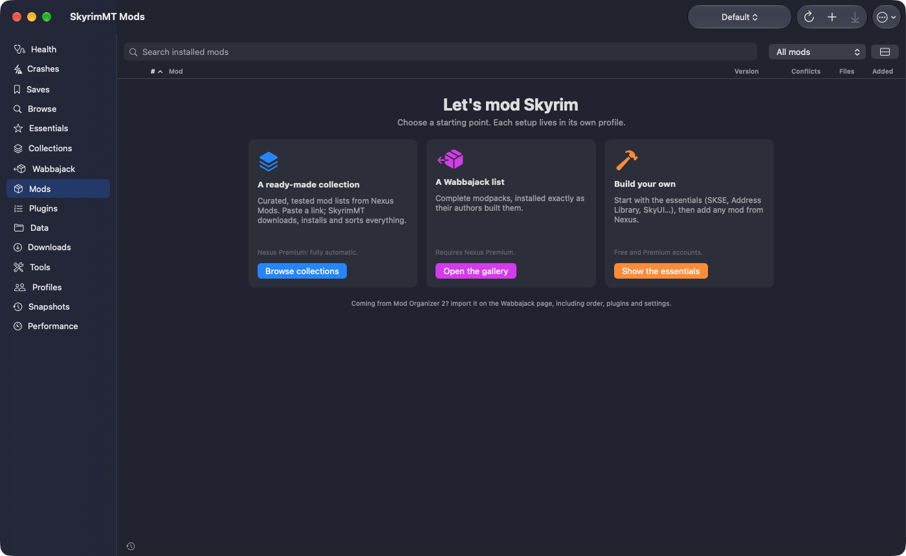
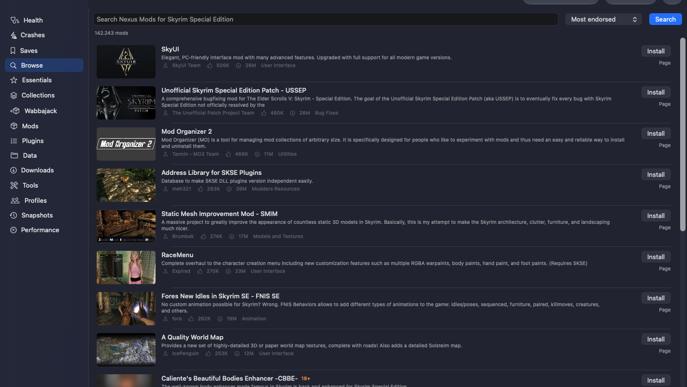
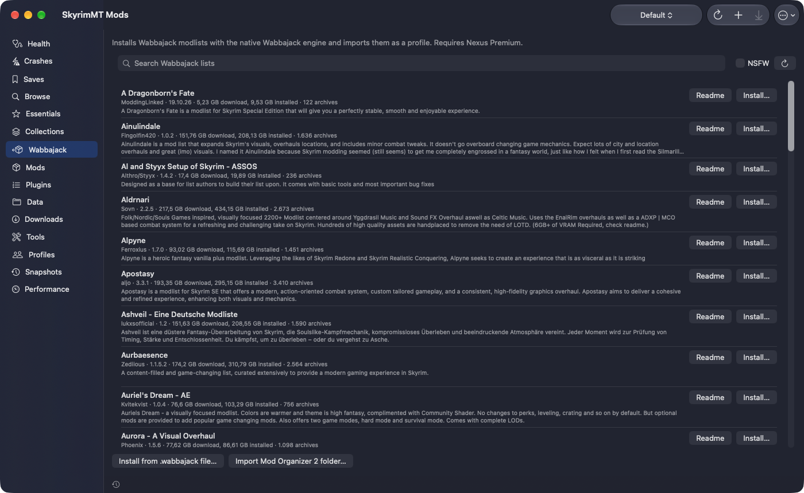
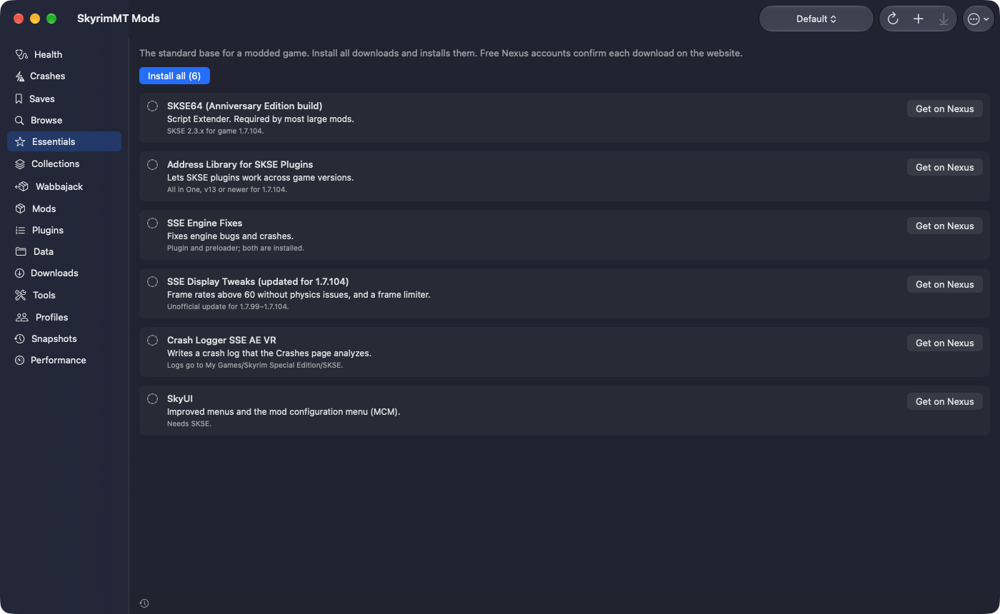
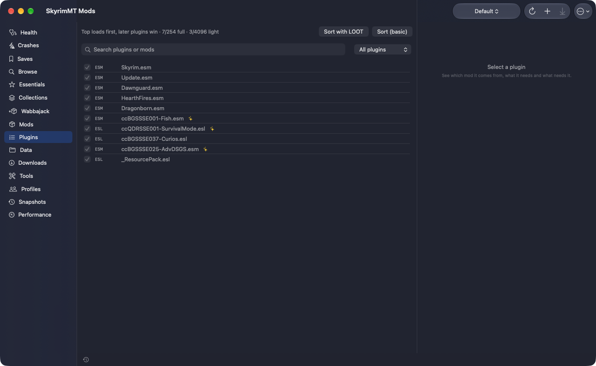
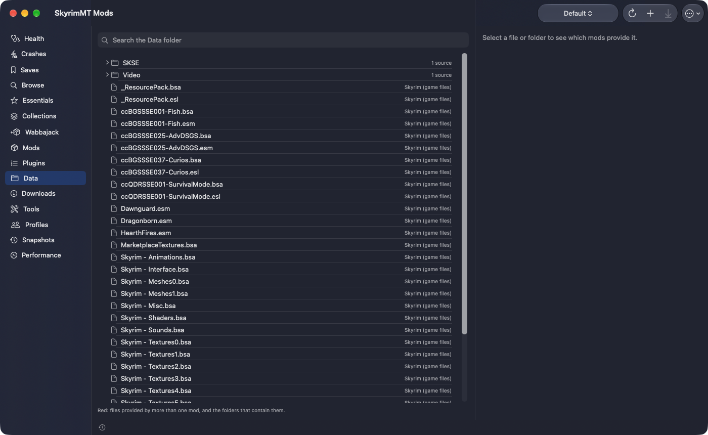
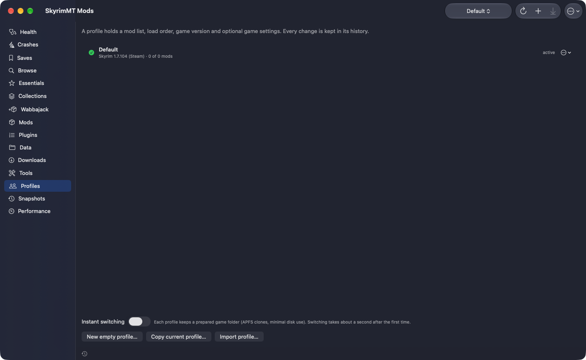
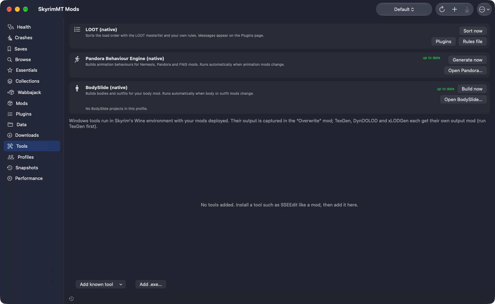

# SkyrimMT

Skyrim Special Edition / Anniversary Edition on Apple Silicon Macs — one-click setup and a native mod manager.

## Features

**Launcher**
- One-click setup: Wine, Steam and Skyrim in a self-contained folder
- Direct3D 11 → Metal (DXMT), SKSE launch, no Bethesda launcher
- Graphics presets, frame-rate cap, controllers, smooth mouse
- Pin older Skyrim versions; built-in updater

**Mod manager**
- Archive and FOMOD installs, choice of Nexus files, empty mods
- Nexus Mods: browse, Mod Manager Download, updates, endorse, track
- Nexus Collections and Wabbajack modlists; Mod Organizer 2 import
- Essentials (SKSE, Address Library, Engine Fixes, SkyUI…) in one click
- Conflicts, priorities, categories, colour tags, notes
- Data folder view with per-file origin and conflicts
- LOOT sorting, load-after rules, plugin locks, ESL flagging, xEdit cleaning
- Profiles with history, own INIs and saves; instant profile switching
- Snapshots before every risky change; one-click restore
- Health checks: missing masters, requirements, duplicates
- Crash log analysis with automatic suspect testing
- Save inspector, save guard and backups
- Per-mod performance measurement
- Native LOOT, Pandora and BodySlide; xEdit, DynDOLOD and other tools in Wine
- Reorderable sidebar, keyboard shortcuts, undo

## Screenshots

| | |
|---|---|
|  **Setup** — everything installed in one click |  **Mods** — start from a collection, a Wabbajack list or your own |
|  **Browse** — search and install from Nexus Mods |  **Wabbajack** — modlists installed natively |
|  **Essentials** — the standard base in one click |  **Plugins** — load order and LOOT |
|  **Data** — every file and the mod it comes from |  **Profiles** — separate setups, instant switching |
|  **Tools** — LOOT, Pandora, BodySlide, Windows tools | |

## Requirements
- Apple Silicon, macOS 13 or newer
- Skyrim Special Edition on Steam
- ~25 GB free disk space
- Nexus Mods account (Premium for fully automatic downloads)

## Install
1. Download `SkyrimMT-app.zip` from [Releases](../../releases) and move SkyrimMT to Applications.
2. First launch: right-click → **Open** (the app is not notarized).
3. Setup tab → **Set up everything**, sign in to Steam, confirm the Skyrim install.
4. Mod Manager → Essentials → add your Nexus API key → **Install all**.

## Legal
MIT licence ([LICENSE](LICENSE)). No Bethesda, Valve or Nexus Mods content is included or redistributed. Not affiliated with Bethesda, Valve or
Nexus Mods. Third-party components: [THIRD_PARTY.md](THIRD_PARTY.md).

## Maintainers
- **Build:** `app/build.sh` (Xcode Command Line Tools, Rust, mingw-w64). `--no-install` builds without installing.
- **Tests:** `tests/modkit/run.sh` (`all`, `profiles`, `slots`, `bench`, …).
- **Layout:** `app/` SwiftUI app · `app/ModKit/` mod manager core · `scripts/` Wine/Steam/game shell scripts ·
  `helpers/loot/` LOOT helper (Rust) · `tools/` patches and build scripts · `config/` defaults and `release.conf`.
- **Native tools:** `tools/{pandora,bodyslide,wabbajack}/build.sh` build from pinned upstream source + `macos.patch`.
  Release archives and their checksums go in `config/release.conf`; attach the patched sources to the release.
- **Release:** tag `vX.Y.Z`, run `app/build.sh`, attach `build/app/SkyrimMT-app.zip` and the tool archives. The
  built-in updater reads the latest GitHub release.
